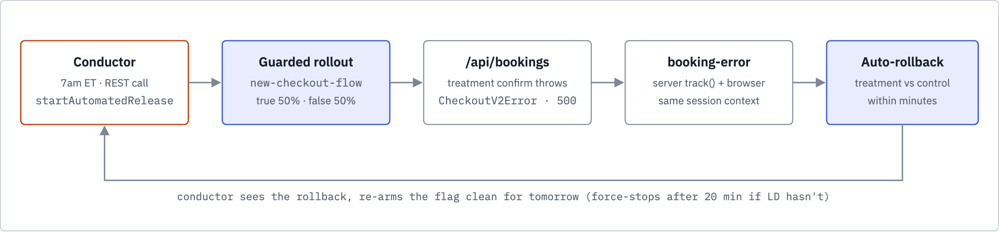

# Toggle Travel — LaunchDarkly

A demo travel booking app built to showcase observability tooling. The same application runs across multiple EC2 instances — each branch is instrumented with a different vendor so you can compare what each tool sees from identical traffic.

## Architecture


Gray arrows are app traffic and external calls, blue arrows touch LaunchDarkly, and orange is the daily incident path. The server and the browser each hold their own LaunchDarkly connection, so a flag change reaches pages and API handlers at the same time without a deploy.

**Daily checkout incident.** At 7am ET the traffic conductor starts a guarded rollout of `new-checkout-flow`. Treatment-arm checkouts return a 500 and send `booking-error`, and LaunchDarkly compares that arm against the control arm and rolls it back.



## Stack

| Layer | Technology |
|---|---|
| Runtime | Node.js 20 + Express |
| Process manager | PM2 (2 cluster instances) |
| Reverse proxy | Nginx |
| Logging | Winston (structured JSON) |
| AI feature | Anthropic Claude API (Toggle Vacation Mode) |
| Infrastructure | AWS EC2 (t2.medium) |
| CI/CD | GitHub Actions → SSH deploy |

## Branch Strategy

Each branch targets a dedicated EC2. The only diff between `main` and a vendor branch is the vendor's nav badge and any SDK instrumentation code.

| Branch | Vendor | EC2 Secrets |
|---|---|---|
| `main` | Clean base — no vendor code | — |
| `dynatrace` | Dynatrace OneAgent | `EC2_HOST_DT` / `EC2_SSH_KEY_DT` |
| `launchdarkly` | LaunchDarkly Observability | `EC2_HOST_LD` / `EC2_SSH_KEY_LD` |
| `datadog` | Datadog Agent + dd-trace | `EC2_HOST_DD` / `EC2_SSH_KEY_DD` |
| `grafana` | Grafana Alloy + OTLP | `EC2_HOST_GF` / `EC2_SSH_KEY_GF` |

> Adding a new vendor: branch off `main`, add the vendor's badge to `nav.js`, add SDK/agent setup, create a deploy workflow following the existing pattern.

## What the App Does

- **Destination catalog** — 12 travel destinations with simulated weather and dynamic pricing
- **Search** — filter by region, price, keyword, departure date
- **Booking flow** — inventory check → payment authorization (5% simulated decline rate) → confirmation
- **Toggle Vacation Mode** — calls Claude AI with user preferences, returns a travel persona + 3 personalized destination recommendations; every call is logged with token counts and duration
- **Simulated latency** — configurable via `SIMULATE_LATENCY_MAX_MS` env var
- **External mock services** — weather API (50–200ms), pricing engine (100–400ms, 3% timeout), payment processor (100–300ms, 5% decline)

## Telemetry Signals

Every request produces structured JSON logs (Winston). Key events:

| Event | Fields |
|---|---|
| `http_request` | method, path, status_code, duration_ms, session_id, ip, user_agent |
| `booking_stage` | stage (inventory_check / payment_authorized / payment_declined), booking_id, duration_ms, session_id |
| `booking_created` | booking_id, destination, travelers, total_amount, transaction_id, session_id |
| `payment_authorized` | transaction_id, amount |
| `vacation_mode_toggled` | enabled, model, duration_ms, input_tokens, output_tokens |
| `destinations_listed` | count |
| `weather_api_response` | destination_id, temperature, condition |
| `pricing_engine_response` | destination_id, multiplier |

Log files on EC2: `/var/log/toggle-travel/out-{0,1}.log` and `error-{0,1}.log`

## Local Setup

```bash
git clone https://github.com/bobby-digital-insanity/toggleTravel
cd toggleTravel
cp .env.example .env
# Add your ANTHROPIC_API_KEY to .env
npm install
npm run dev
```

App runs at `http://localhost:3000`

## Generating Traffic

The seed load script simulates realistic user sessions:

```bash
# Default: 3 rounds against localhost
node scripts/seed-load.js

# Against a live EC2
node scripts/seed-load.js --host http://<EC2-IP> --rounds 5

# Extended demo session with longer pauses between rounds
node scripts/seed-load.js --host http://<EC2-IP> --rounds 10 --pause 30
```

**Five flow types per round:**

| Flow | Description | Requests |
|---|---|---|
| Window Shopper | Browses destinations, never books | ~5 |
| Abandoned | Searches and views but walks away | ~7 |
| Complete Booking | Full happy path with confirmation | ~7 |
| Vacation Mode | AI feature with preferences | ~3 |
| Error Spike | Intentional 400/404s for error rate signals | ~4 |

Each round is ~25–30 requests. A 3-round run takes roughly 3–4 minutes.

## EC2 UserData

See `deployment/user-data.sh` for the full bootstrap script. Requires these SSM Parameter Store entries before launch:

- `/toggletravel/anthropic-api-key`
- `/toggletravel/claude-model` (optional, defaults to `claude-opus-4-5`)
